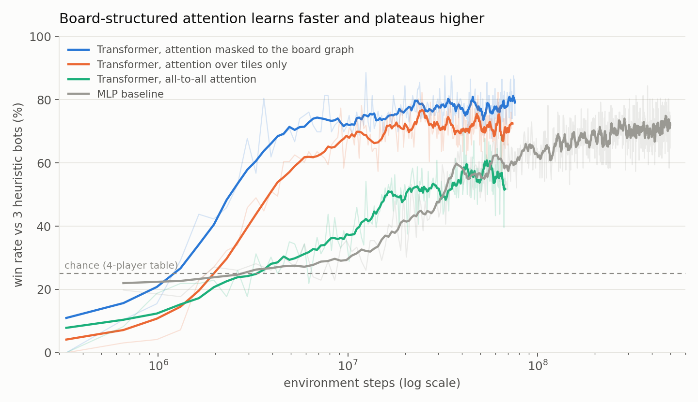

# rl-catan

Reinforcement-learning agents for *Settlers of Catan*, benchmarked against the
[Catanatron](https://github.com/bcollazo/catanatron) bots.

## Highlights

- **Near-parity with Catanatron's AlphaBeta bot.** A learned policy combined with
  policy-pruned search wins ~48% of 1v1 games against `AlphaBetaPlayer(n=2)`.
- **Board-graph attention.** A transformer whose attention follows the board's
  adjacency beats an MLP with 25× fewer training steps (plot below).
- **Cross-engine play.** Networks trained in the fast Rust engine play directly
  against Catanatron's bots through a coordinate adapter.

<p align="center">
  
</p>

## Results

1v1 win rates against Catanatron's bots (10 VP to win, 40–500 games per entry;
"–" means not measured).

| Agent | vs WeightedRandom | vs ValueFunction | vs AlphaBeta(2) |
|---|---|---|---|
| PPO (BoardCNN) | 71% | 9% | 7% |
| PPO + UCB1 root search | – | 16% | 16% |
| Behaviour clone of ValueFunctionPlayer | 100% | 43% | 29% |
| Behaviour clone + policy-pruned alpha-beta (depth 3) | – | 30% | 45% |
| Rust-engine graph transformer | – | – | 30% |
| Rust-engine graph transformer + policy-pruned search (depth 3) | – | – | **48%** |
| *Catanatron `ValueFunctionPlayer` (reference)* | *100%* | – | *52%* |
| *Catanatron `AlphaBetaPlayer(n=2)` (reference)* | *100%* | *48%* | – |

Our search runs one level deeper than AlphaBeta(2). At equal depth the best
agents reach 22–37%.

## What worked

- **Behaviour cloning.** A 6-minute clone of `ValueFunctionPlayer` beat every
  multi-day PPO run.
- **Search on top of a good policy.** Pruning each node to the policy's top
  moves makes depth-3 search affordable, and it lifts win rates 1.5–2.5×.
- **Spatial policies.** Scoring each placement from features at that board
  location, and attention masked to the board graph.

## What didn't

- **Plain PPO.** It plateaued near 5% against `ValueFunctionPlayer` across
  about ten runs.
- **PPO fine-tuning of the behaviour clone.** It collapsed every time. A
  KL anchor prevents the collapse but caps the agent at clone level.
- **Learned value functions.** They failed both as search leaves and as
  expert-iteration targets; Catanatron's handcrafted evaluation was better.
- **Stronger in-engine opponents.** Training against them raised in-engine
  win rates, but not results against Catanatron's bots.

Details and sample sizes are in [`docs/EXPERIMENTS.md`](docs/EXPERIMENTS.md).

## Repository layout

```
catan_rl/            Python package (Catanatron + Stable-Baselines3 stack)
  env/               reward shaping and action-mask wrappers
  features/          feature extractors: BoardCNN, HexEncoder, HexFormer, XDim
  policies/          factorized and spatial (pointer-head) MaskablePPO policies
  training/          PPO loop, opponent curricula, KL anchor, callbacks
  search/            UCB1 root search, policy-pruned alpha-beta players
  eval/              ladder vs Catanatron bots, Rust-net adapter
  players/           RLPlayer: a trained policy as a Catanatron Player
scripts/             training, behaviour cloning, ExIt and evaluation entry points
  rust_train/        PPO on the Rust engine (MLP / HexFormer / tiles policies)
rust/                vendored Rust engine (catan-core, catan-env, catan-py, ...)
configs/             YAML configs, one per experiment
tests/               pytest suite
```

## Quickstart

Requires Python 3.11 and [uv](https://docs.astral.sh/uv/). The Rust engine also
needs a Rust toolchain.

```bash
uv sync
uv run pytest
```

**Catanatron stack:** train a spatial-policy PPO agent and evaluate it on the
ladder:

```bash
uv run python scripts/train.py --config configs/spatial_policy.yaml
uv run python -m catan_rl.eval --candidate checkpoint:<run_dir>/model.zip \
    --opponent alphabeta2 --games 100 --mode 1v1
```

**Rust engine:** build the Python bindings, then train the graph-masked
transformer:

```bash
uv pip install maturin
(cd rust/catan-py && uv run maturin develop --release)
uv run python scripts/rust_train/ppo_rust.py --name graph-L3 \
    --arch hexformer --attn graph --layers 3 --hidden 128 \
    --lr 1e-4 --warmup-updates 50 --minibatch 1024 --device mps \
    --steps 100_000_000 --train-seats policy,heuristic,policy,heuristic
```

Behaviour cloning (`scripts/bc_pretrain.py`), critic warmup
(`scripts/critic_warmup.py`) and the ExIt loops (`scripts/exit_*.py`) each
take a `--config` from `configs/`.

## Status

The project is paused. Promising next steps are running the network inside the
Rust engine (so search can use full rollouts as leaf values), expert iteration
on rollout outcomes, and a 2-player fine-tune of the 4-player networks.

## Acknowledgements

This project builds directly on the following work:

- **[Catanatron](https://github.com/bcollazo/catanatron)** by Bryan Collazo:
  the Python game engine, gym environment and benchmark bots (`ValueFunctionPlayer`,
  `AlphaBetaPlayer`) used for all training in the Python stack and for every
  evaluation.
- **[Eli6th/catan-rl](https://github.com/Eli6th/catan-rl)** by Eli Olcott: the
  Rust engine under [`rust/`](rust/) is vendored from this repository (MIT, see
  [`rust/UPSTREAM_LICENSE`](rust/UPSTREAM_LICENSE)). The Rust PPO trainer is
  adapted from its `training/ppo.py`. Our changes to the engine are a
  value-function training seat, a Catanatron weight port with GA tuning, and a
  topology export.
- **Henry Charlesworth, [settlers-rl](https://settlers-rl.github.io)**
  ([code](https://github.com/henrycharlesworth/settlers_of_catan_RL)): the
  multi-head action design, tile attention encoder and lean reward shaping that
  our spatial and transformer policies started from.
- **[nogulong/rust-catan-rl](https://github.com/nogulong/rust-catan-rl)**: the
  archive-league self-play and the training-stability recipe we borrowed from.
- [Stable-Baselines3 / sb3-contrib](https://github.com/DLR-RM/stable-baselines3)
  for `MaskablePPO`.

### References

- Schulman et al., *Proximal Policy Optimization Algorithms*, 2017. [arXiv:1707.06347](https://arxiv.org/abs/1707.06347)
- Anthony, Tian & Barber, *Thinking Fast and Slow with Deep Learning and Tree Search* (ExIt), NeurIPS 2017. [arXiv:1705.08439](https://arxiv.org/abs/1705.08439)
- Gendre & Kaneko, *Playing Catan with Cross-dimensional Neural Network*, 2020. [arXiv:2008.07079](https://arxiv.org/abs/2008.07079)
- Sokota et al., *A Unified Approach to Reinforcement Learning, Quantal Response Equilibria, and Two-Player Zero-Sum Games* (MMD), ICLR 2023. [arXiv:2206.05825](https://arxiv.org/abs/2206.05825)
- Rudolph et al., *Reevaluating Policy Gradient Methods for Imperfect-Information Games*, 2025. [arXiv:2502.08938](https://arxiv.org/abs/2502.08938)

## License

MIT for the code in this repository (see [`LICENSE`](LICENSE)). The vendored
engine under `rust/` keeps its original MIT license.
